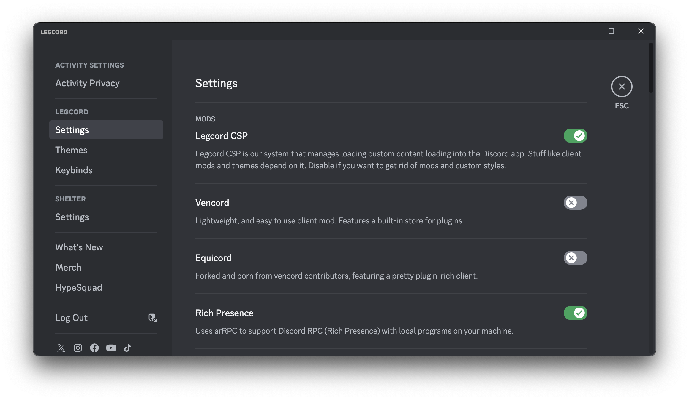
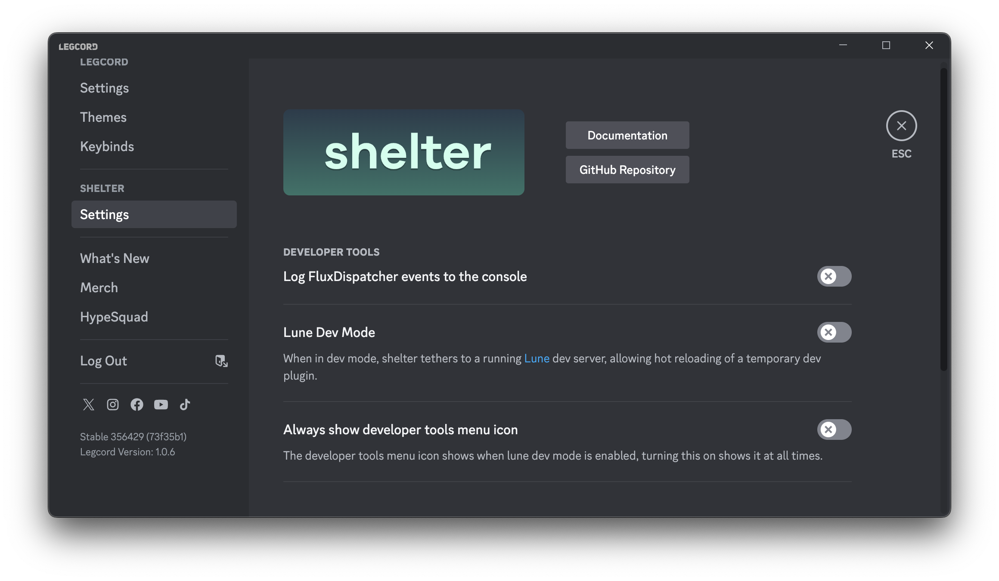
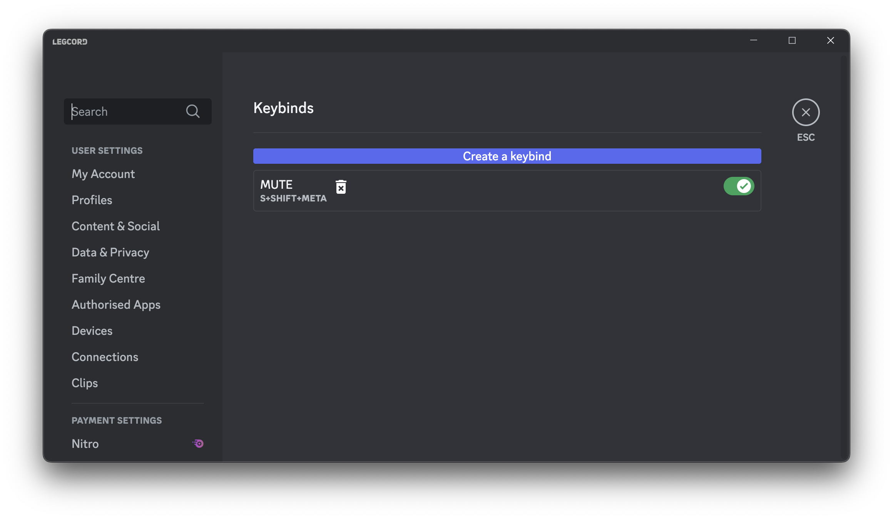

<div align="center">


# Remcord

### Discord, reimagined. Lightweight, private, and truly yours.

*One client for every workflow — mods, themes, and privacy built in, not bolted on.*

[](package.json)
[](license.txt)
[](native/)
[](electron-builder.ts)
[](electron-builder.ts)
[](https://discord.gg/)

[Features](#-why-remcord) • [Screenshots](#-screenshots) • [Install](#-install) • [Build from Source](#-build-from-source) • [FAQ](#-faq) • [Contributing](CONTRIBUTING.md)

</div>

---

> **A standalone Discord client that respects you.** No trackers. No bloat. No compromises.
> Pick a vanilla experience or supercharge it with Vencord, Equicord, and Shelter — all pre-integrated, all optional.

## ✨ Why Remcord?

| | Remcord | Official Client | Typical Wrappers |
|---|---|---|---|
| **Standalone — no Discord install required** | ✅ | — | ⚠️ Varies |
| **Vencord / Equicord / Shelter built in** | ✅ | ❌ | ⚠️ Manual injection |
| **BetterDiscord themes + QuickCSS** | ✅ | ❌ | ⚠️ Partial |
| **Tracker blocking by default** | ✅ | ❌ | ❌ |
| **Rich Presence (arRPC) out of the box** | ✅ | ✅ | ❌ |
| **Portable mode on Windows** | ✅ | ❌ | ⚠️ Varies |
| **Rust + WebView2 production shell (Windows)** | ✅ | — | ❌ |

---

## 🚀 Features

### 💎 Standalone Client
Built from the ground up. Remcord doesn't depend on the official Discord client in any way — it's fast, self-contained, and fully under your control.

### 🧩 Mods, Your Way
Enjoy **Vencord**, **Equicord**, and **Shelter** with one click — or stay completely vanilla. Every mod is optional, sandboxed through a typed native bridge, and manageable from Remcord Settings.

### 🎨 Themes Without Limits
Natively theme the *entire* app. Import BetterDiscord themes, manage them visually, and fine-tune everything with QuickCSS and live reload.

### 🔒 Made for Privacy™
Discord's trackers are blocked automatically. Even with zero mods enabled, you browse, chat, and call with confidence.

### 🎮 Rich Presence, Included
Show what you're playing with first-class game activity powered by [arRPC](https://arrpc.openasar.dev) — no setup, no plugins required.

### 🪟 Native Feel on Windows
The production Windows app is a **Rust + WebView2 shell** — built and signed in CI. Enjoy transparency, Fluent-inspired styling, and deep OS integration without Electron overhead.

> ℹ️ **Note on sources:** the `src/` Electron tree is now stale legacy reference code. It is no longer built, signed, or released.

### 🌍 Cross-Platform
Originally created to bring Discord to **AArch64 Linux** devices. Today Remcord builds for Windows, Linux, and macOS from a single codebase.

---

## 📸 Screenshots

<div align="center">

| Settings | Shelter Integration | Keybinds |
|---|---|---|
|  |  |  |

*Clean settings. Powerful mods. Familiar Discord — only better.*

</div>

---

## 📦 Install

### Windows — Recommended

Build the signed installer from source (requires **Inno Setup 6**):

```powershell
.\native\installer\build-installer.ps1
# → Remcord-Setup-<version>.exe
```

**Portable mode:** tick “Keep my Remcord data next to the app” during setup — or create a folder named `remcord-data` next to your Remcord executable and launch. All profiles, themes, and settings stay local to that folder, wherever you installed. Otherwise (default) user data lives in `%LOCALAPPDATA%\Remcord` and survives uninstalls and upgrades.

### Linux

Build distributable targets from source:

```bash
pnpm run package
```

Configured targets in [`electron-builder.ts`](electron-builder.ts): **AppImage, deb, rpm, tar.gz**, plus Flatpak metadata.

### macOS

```bash
pnpm run package
```

See [`electron-builder.ts`](electron-builder.ts) for targets and signing configuration.

> Packaged distributions for the renamed product ship under new identifiers. Previous-generation marketplace listings remain with the previous generation and are not renamed in place.

---

## 🛠️ Build from Source

**Prerequisites:** [Node.js v26+](https://nodejs.dev) and [pnpm](https://pnpm.io/installation#using-npm)

```bash
# 1. Clone
git clone https://github.com/Legcord/Legcord.git
cd Legcord

# 2. Install dependencies
pnpm install

# 3. Build
pnpm run build

# 4. Package
pnpm run package
```

**Native Windows shell (Rust):**

```powershell
# Dev launch (isolated WebView2 profile)
.\native\run-dev.ps1

# Or via Cargo directly
cargo run --manifest-path .\native\Cargo.toml
```

See [`native/README.md`](native/README.md) and [`native/COMPATIBILITY.md`](native/COMPATIBILITY.md) for architecture details, checks, and diagnostic probes.

---

## 🎛️ Usage

1. Launch Remcord and log in as usual.
2. Open **Discord Settings → Remcord Settings** (white Discord icon) — or right-click the tray icon → **Open Settings**.
3. Enable mods, install themes, tweak privacy, transparency, and behavior.
4. Restart only when prompted — most changes apply live.

**Pro tips:**
- `QuickCSS` edits apply instantly with live reload.
- Themes live in your profile's `themes/<id>/` folder with a `manifest.json`.
- Portable installs keep everything in `remcord-data/` — perfect for USB sticks.

---

## ❓ FAQ

<details>
<summary><b>Do you have a support Discord?</b></summary>

Yes — we'd love to see you there:

[](https://discord.gg/)

Report bugs, share themes, get help, and vote on features.

</details>

<details>
<summary><b>Will I get banned for using Remcord?</b></summary>

You are technically breaking [Discord's ToS](https://discord.com/terms#software-in-discord%E2%80%99s-services) by using any custom client. In practice, **no one has been banned** for using Remcord or any of its included mods — but use at your own discretion.

</details>

<details>
<summary><b>How do I access settings?</b></summary>

Open Discord Settings and click **Remcord Settings**, or right-click the tray icon and choose **Open Settings**.

</details>

<details>
<summary><b>How does Remcord work?</b></summary>

The production Windows app is a Rust WebView2 shell wrapping the official web app, with a typed native bridge for mods, themes, settings, and presence. No installers or injectors needed — themes and mods load seamlessly, with transparency and Fluent-inspired styling, plus deep optimizations for a smooth experience.

</details>

<details>
<summary><b>Is there a portable mode?</b></summary>

Yes. Tick “Keep my Remcord data next to the app” during setup — or create a folder called `remcord-data` beside your executable (use the zip/archive build) and launch. Everything stays in that folder, and uninstalling never deletes it.

</details>

<details>
<summary><b>Where is the source code?</b></summary>

Right here — it ships with this repository under `OSL-3.0`. See [Contributing](CONTRIBUTING.md).

</details>

<details>
<summary><b>How can I help translate?</b></summary>

Translations are managed on our [Weblate page](https://hosted.weblate.org/projects/armcord/). Every language you add helps someone feel at home.

</details>

---

## 🌐 Translate, Contribute, Shape the Future

Remcord is community-driven. Whether you fix a typo, add a language, design a theme, or hack on the Rust shell — you belong here.

- 📖 Read [CONTRIBUTING.md](CONTRIBUTING.md)
- 💬 Join [discord.gg/](https://discord.gg/)
- 🐛 Open issues with repro steps and logs

---

## 🙏 Credits

Built on the shoulders of giants:

- [kckarnige — UI design, branding, and features](https://github.com/kckarnige)
- [OpenAsar](https://github.com/GooseMod/OpenAsar)
- [Legcord](https://github.com/Legcord/Legcord)
- [arRPC — Rich Presence](https://github.com/OpenAsar/arrpc)
- [Vencord](https://github.com/Vendicated/Vencord) • [Equicord](https://github.com/Equicord/Equicord) • [Shelter](https://github.com/uwu/shelter)
- [electron-builder](https://electron.build)

---

## 📄 License

Licensed under the **Open Software License v3.0 (OSL-3.0)** — see [license.txt](license.txt).

---

<div align="center">

**Remcord — your Discord, your rules.**

*Discord is a trademark of Discord Inc. Remcord is not affiliated with or endorsed by Discord Inc.*
*Remcord is not affiliated with or endorsed by ARM Limited.*

⭐ Star us if Remcord made your Discord better — it keeps us building. ⭐

</div>
